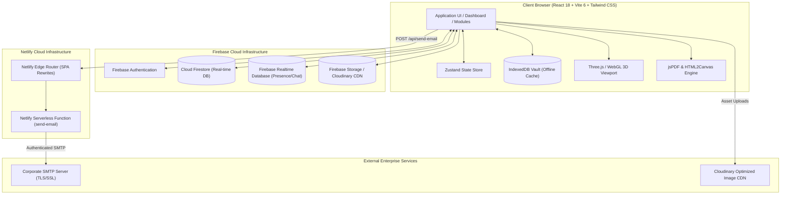

# JQMS Enterprise — Construction Quality Management System

<div align="center">


**Enterprise-Grade Civil & Structural Quality Management, Digital Inspections, Concrete & Rebar Analytics, Executive Presentation Reporting, and Multi-Tenant Project Governance.**

[](https://reactjs.org/)
[](https://www.typescriptlang.org/)
[](https://vitejs.dev/)
[](https://tailwindcss.com/)
[](https://threejs.org/)
[](https://firebase.google.com/)
[](https://www.netlify.com/)
[](LICENSE)

[Features](#-key-features--modules) • [Architecture](#-architecture--data-flow) • [Engineering Standards](#-engineering-standards--compliance) • [Getting Started](#-getting-started) • [Configuration](#-configuration--environment) • [Deployment](#-deployment-guide) • [RBAC](#-role-based-access-control-rbac)

---

</div>

## 📌 Executive Summary

**JQMS Enterprise** is a mission-critical digital quality management platform engineered specifically for high-rise, infrastructure, and large-scale civil construction developments. It bridges the gap between field engineering teams, QA/QC managers, project directors, and consultants by replacing paper checklists and disjointed spreadsheets with real-time auditability, standard-compliant structural registries, and executive-level landscape reporting decks.

### Core Objectives
- **Zero-Loss Traceability**: Track structural elements from design intent, bar cutting, pre-pour inspection, concrete batching, compressive strength curing, to handover sign-off.
- **Standards-Grounded Engineering**: Built natively around British Standards (`BS EN`), American Standards (`ASTM`), and International Quality Systems (`ISO 9001:2015`).
- **Real-Time Multi-Tenant Governance**: Granular 5-level role-based access control (RBAC) supporting multi-company environments and project-specific permission boundaries.
- **Offline-First Resilience**: IndexedDB-backed offline vault (`idb`) that caches field inputs and automatically syncs when network connectivity is restored.
- **Dual-Engine Executive Reporting**: High-resolution vector PDF generators (`jsPDF`) combined with an interactive 16:9 landscape presentation deck engine for weekly client and executive boardroom reviews.

---

## 🚀 Key Features & Modules

### 1. Quality Assurance & Non-Conformance Management
- **NCR (Non-Conformance Reports)**: Full lifecycle workflow (Issuance $\rightarrow$ Root Cause Analysis $\rightarrow$ Proposed Disposition $\rightarrow$ Corrective & Preventive Action $\rightarrow$ Re-inspection $\rightarrow$ Close-out) with photographic evidence and digital signature sign-offs.
- **Site Instructions (SI)**: Formal engineer instructions linked directly to structural levels and elements with mandatory contractor acknowledgment and compliance tracking.
- **Site Comments (SC)**: Rapid field observation logging with geotagged media and priority grading (Minor, Moderate, Critical).
- **RFI (Request for Information)**: Clarification query engine connecting contractor site teams with structural, architectural, and MEP consultants.
- **MAR & MIR (Material Submittals & Site Ingestion)**:
  - **MAR (Material Approval Request)**: Spec sheet verification, manufacturer test certificate (MTC) audits, and consultant approvals.
  - **MIR (Material Inspection Request)**: Gatekeeper receiving inspection on physical site delivery with batch number verification and QA/QC approval.

### 2. Inspection & Test Plans (ITP) & Digital Checklists
- **Dynamic Trade & ITP Registry**: Built-in master templates across Earthworks, Concrete, Structural Steel, Waterproofing, Masonry, MEP, and Architectural Finishes.
- **Inspection Gates**: Strict enforcement of **Hold Points (H)**, **Witness Points (W)**, **Review Points (R)**, and **Surveillance Points (S)**.
- **Interactive Checklists**: Real-time pass/fail inspection item sign-offs with GPS-validated timestamps and audit signatures.

### 3. Concrete Batching & Early Strength Analytics
- **Permit to Pour (PTP)**: Multi-trade digital clearance gate (Rebar, Formwork, MEP Cast-in, Cleanliness, Surveyor Levels) required before any concrete discharge.
- **Concrete Cube Compression Registry**:
  - Compliant with **BS EN 12390-3**, **ASTM C39**, and **IS 516**.
  - Track 3-day, 7-day, 14-day, and 28-day curing tests against target characteristic strength ($f_{ck}$).
  - Real-time early-strength regression forecasting: warns engineers if 7-day results project a 28-day failure.
  - Density calculations ($kg/m^3$), fracture type classification, and automated batch compliance flags.

### 4. Bar Bending Schedule (BBS) & Rebar Optimization
- **Rebar Cutting Registry**: Compliant with **BS 8666** and **ASTM A615** standard shape codes.
- **1D Cutting Stock Optimization**: Algorithmic linear-programming optimizer to calculate minimum scrap patterns from standard 12-meter commercial stock lengths.
- **Tensile & Bend Test Log**: Yield strength ($R_e$), ultimate tensile strength ($R_m$), elongation ratio, and cold-bend test verification.

### 5. Spatial 2D & 3D Interactive Visualization
- **3D Structural Model Viewer**: WebGL canvas powered by **Three.js** and **React Three Fiber** for visualizing building levels, structural elements, and real-time pour status.
- **Interactive 2D Grid Plan Overlays**: Interactive structural slab layouts with click-to-inspect element cards, CAD gridlines, and defect heatmaps.

### 6. Executive Weekly Reporting & Presentation Deck Engine
- **16:9 Landscape Executive Slides**: Interactive cockpit featuring Executive Command Matrix, Level Progress Completion, Quality KPI Trendlines, Cube Strength Histograms, and Photographic Progress.
- **Direct PDF Export**: High-resolution print engine matching presentation styling with embedded SVG vector charts and CAD overlays.
- **Theme-Responsive UI**: Seamless switching between Dark Slate and Clean Light presentation modes.

### 7. Action Center, Site Diary & Handover
- **Action Center**: Consolidated cockpit of pending sign-offs, overdue NCRs, expiring RFIs, and high-priority inspections.
- **Daily Site Diary**: Manpower headcounts, plant/equipment utilization, weather logs, and daily progress logs.
- **Punch List & Handover**: Room-by-room snagging tracker with handover Taking-Over Certificate (TOC) generation.

### 8. Corporate SMTP Gateway & Email Relay
- **Netlify Serverless Relay**: Secure backend function (`netlify/functions/send-email.ts`) powered by **Nodemailer**.
- **Per-Company SMTP Server Configuration**: Support for custom corporate SMTP relays (Host, Port, Secure/TLS, Username, Password).
- **Personal Engineer Credentials & Auto-Signatures**: Engineers can configure individual sender mailboxes and embed high-resolution company logos in their HTML email signatures.

---

## 🏗 Architecture & Data Flow



---

## 🗂 Project Directory Structure

```text
jay-qms/
├── netlify/
│   └── functions/
│       └── send-email.ts            # Serverless SMTP relay using Nodemailer
├── public/                          # Static assets, fallback logos, fonts
├── src/
│   ├── components/
│   │   ├── common/                  # Shared UI (Navigation, ErrorBoundary, Guards, Modals)
│   │   ├── cube/                    # Concrete cube forms, graphs, test matrices
│   │   ├── dashboard/               # Executive dashboard widgets & metric cards
│   │   ├── itp/                     # Inspection and Test Plan builder & cards
│   │   ├── projects/                # Multi-project selector, creator, editor
│   │   └── reporting/               # Weekly report deck, matrix cockpit, slide components
│   ├── lib/
│   │   ├── audit.ts                 # Audit logging helper
│   │   ├── barCuttingOptimizer.ts   # 1D knapsack stock cutting optimizer
│   │   ├── bbsParser.ts             # BBS shape code and bend parser
│   │   ├── cloudinary.ts            # Image optimization and Cloudinary upload helper
│   │   ├── companyHelper.ts         # Company settings & SMTP configuration manager
│   │   ├── db.ts                    # Firestore CRUD, queries, and offline cache hydration
│   │   ├── idbVault.ts              # IndexedDB local storage engine
│   │   ├── pdfGenerators.ts         # Multi-module jsPDF vector document builder
│   │   ├── permissions.ts           # Role hierarchy, capabilities, and permission checks
│   │   └── rbac.tsx                 # React RBAC Gate components & hooks
│   ├── pages/                       # 30+ Dedicated Module & Registry Pages
│   │   ├── Dashboard.tsx            # Project executive KPI dashboard
│   │   ├── WeeklyReportDetail.tsx   # 16:9 Landscape Executive Report Deck
│   │   ├── NCRModule.tsx            # Non-conformance registry & workflow
│   │   ├── PermitToPourDetail.tsx   # Concrete pour permit & sign-off gate
│   │   ├── CubeDetails.tsx          # Concrete test register & early strength curve
│   │   ├── BarCuttingRegistryPage.tsx # Rebar cutting schedule manager
│   │   ├── Settings.tsx             # Company & corporate SMTP configuration
│   │   ├── ProfilePage.tsx          # Personal mailbox, signatures & company logo
│   │   └── ...
│   ├── services/
│   │   ├── emailService.ts          # Email dispatch helper & HTML signature builder
│   │   └── pdf/                     # Modular PDF generators (Weekly Reports, NCR, etc.)
│   ├── types/                       # TypeScript domain interfaces & enumerations
│   ├── App.tsx                      # App routing, code-splitting & layout wrappers
│   ├── firebase.ts                  # Firebase client SDK initialization
│   ├── index.css                    # Tailwind CSS base styles & CSS custom properties
│   └── main.tsx                     # React DOM root entrypoint
├── netlify.toml                     # Netlify build configuration & redirect routes
├── package.json                     # NPM project metadata & dependencies
├── tsconfig.json                    # TypeScript compiler configuration
├── vite.config.ts                   # Vite configuration (Path aliases, plugins)
└── tailwind.config.js               # Tailwind styling & dark mode palette
```

---

## 🛡 Role-Based Access Control (RBAC)

JQMS enforces a hierarchical 5-level security matrix to guarantee data governance across corporate management, engineering teams, and subcontractors:

| Level | Role Identifier | Title | Core Capabilities |
| :---: | :--- | :--- | :--- |
| **5** | `SUPER_ADMIN`<br>`QUALITY_DIRECTOR`<br>`EXECUTIVE_MANAGEMENT` | **Corporate Executive** | Full multi-company control, corporate SMTP configuration, company-wide user management, master trade definitions, global audit trail access. |
| **4** | `PROJECT_MANAGER`<br>`OPERATIONS_MANAGER`<br>`QAQC_MANAGER` | **Project Director / Lead** | Project creation & configuration, team role assignments, ITP master sign-offs, Weekly Report approval, high-level project deletion/archival. |
| **3** | `QAQC_ENGINEER`<br>`SENIOR_INSPECTOR`<br>`CONSULTANT_REPRESENTATIVE` | **QA/QC Engineer / Consultant** | Approve & close NCRs, sign off Permit to Pour gates, approve Material Submittals (MAR/MIR), approve RFI resolutions, issue Site Instructions. |
| **2** | `SITE_ENGINEER`<br>`FIELD_INSPECTOR`<br>`SUBCONTRACTOR_LEAD` | **Field Engineer** | Create & submit inspection requests, log daily site entries, record concrete cube test readings, draft NCRs and RFIs, enter bar cutting schedules. |
| **1** | `SUBCONTRACTOR_WORKER`<br>`CONSULTANT_OBSERVER`<br>`VIEWER` | **Observer / Subcontractor** | Read-only access to assigned projects, view open punch lists, acknowledge site instructions, view approved construction drawings. |

---

## 📐 Engineering Standards & Compliance

The calculation engines within JQMS are strictly modeled after international standards:

- **Concrete Compressive Strength**:
  - `BS EN 12390-3`: Testing hardened concrete — Compressive strength of test specimens.
  - `ASTM C39 / C39M`: Standard Test Method for Compressive Strength of Cylindrical Concrete Specimens.
  - `IS 516`: Method of Tests for Strength of Concrete.
- **Reinforcing Steel & BBS**:
  - `BS 8666`: Scheduling, dimensioning, bending, and cutting of steel reinforcement for concrete.
  - `BS 4449`: Steel for the reinforcement of concrete — Weldable reinforcing steel.
  - `ASTM A615 / A615M`: Standard Specification for Deformed and Plain Carbon-Steel Bars for Concrete Reinforcement.
- **Quality Management System**:
  - `ISO 9001:2015 Clause 9.1`: Monitoring, measurement, analysis, and evaluation of quality performance.

---

## ⚡ Getting Started

### Prerequisites
- **Node.js**: `v18.x` or `v20.x` LTS recommended
- **npm**: `v9.x` or higher (or `pnpm` / `yarn`)
- **Firebase Project**: An active Firebase project with Firestore, Authentication, and Storage enabled.

### Installation

1. **Clone the Repository**:
   ```bash
   git clone https://github.com/your-org/jay-qms.git
   cd jay-qms
   ```

2. **Install Dependencies**:
   ```bash
   npm install
   ```

3. **Configure Environment Variables**:
   Create a `.env.local` file in the root directory (refer to [Configuration](#-configuration--environment)):
   ```bash
   cp .env.example .env.local
   ```

4. **Start Local Development Server**:
   ```bash
   npm run dev
   ```
   Open your browser at `http://localhost:5173`.

---

## ⚙ Configuration & Environment

### 1. Firebase Client Configuration (`src/firebase.ts`)
Update `src/firebase.ts` or provide environment variables for your Firebase project:
```typescript
const firebaseConfig = {
  apiKey: import.meta.env.VITE_FIREBASE_API_KEY,
  authDomain: import.meta.env.VITE_FIREBASE_AUTH_DOMAIN,
  projectId: import.meta.env.VITE_FIREBASE_PROJECT_ID,
  storageBucket: import.meta.env.VITE_FIREBASE_STORAGE_BUCKET,
  messagingSenderId: import.meta.env.VITE_FIREBASE_MESSAGING_SENDER_ID,
  appId: import.meta.env.VITE_FIREBASE_APP_ID,
};
```

### 2. Cloudinary Media CDN (Optional for High-Res Photos)
To enable automatic client-side photo compression and Cloudinary CDN uploads:
```env
VITE_CLOUDINARY_CLOUD_NAME=your_cloud_name
VITE_CLOUDINARY_UPLOAD_PRESET=your_unsigned_preset
```

### 3. Corporate SMTP & Email Server Relay
JQMS allows companies to send emails through their own corporate SMTP gateway (e.g., Microsoft 365, Google Workspace, AWS SES, or private SMTP servers):

1. **Navigate to Company Settings** (`/company/settings`).
2. **Configure Corporate SMTP Relay**:
   - **SMTP Host**: `smtp.office365.com` / `smtp.gmail.com` / `mail.yourcompany.com`
   - **SMTP Port**: `587` (STARTTLS) or `465` (SSL)
   - **Secure Connection**: `TLS` / `SSL`
   - **Sender Email & Authentication**: Corporate system sender address and credentials.
3. **Configure Engineer Mailbox & Email Signature** (`/project/profile`):
   - Set individual engineer credentials if sending via personal mailbox.
   - Click **"Embed Company Logo in Email Signature"** to automatically include the high-resolution company branding logo in all outgoing formal emails (NCRs, Weekly Reports, RFIs).

---

## 📦 Build & Deployment

### Production Build
To create an optimized, type-checked production bundle:
```bash
npm run build
```
This executes `tsc` (TypeScript compiler) followed by `vite build`, outputting compiled assets into the `dist/` directory.

### Deploying to Netlify (Recommended)
This repository contains a pre-configured `netlify.toml` file with serverless function routing:

1. **Connect Git Repository** to [Netlify](https://www.netlify.com/).
2. **Build Settings**:
   - **Build Command**: `npm run build`
   - **Publish Directory**: `dist`
   - **Functions Directory**: `netlify/functions`
3. **Environment Variables**:
   Add `VITE_FIREBASE_*` and any other custom environment variables in **Site configuration $\rightarrow$ Environment variables**.
4. **Deploy**: Netlify will automatically build the React SPA and compile the `netlify/functions/send-email.ts` serverless relay.

### Testing Netlify Functions Locally
To test the serverless SMTP relay locally:
```bash
npx netlify dev
```

---

## 🧪 Available Scripts

| Command | Description |
| :--- | :--- |
| `npm run dev` | Starts the Vite local development server with Hot Module Replacement (HMR). |
| `npm run build` | Runs full TypeScript static analysis and builds the production bundle in `dist/`. |
| `npm run preview` | Spins up a local web server to preview the production build output. |

---

## 📄 License & Intellectual Property

This software and associated documentation files are proprietary and confidential. Unauthorized copying, distribution, modification, or deployment of this software, via any medium, is strictly prohibited without the express written permission of the copyright holder.

---

<div align="center">
  <sub>Engineered with precision for Civil & Structural Construction Quality Management.</sub>
</div>
