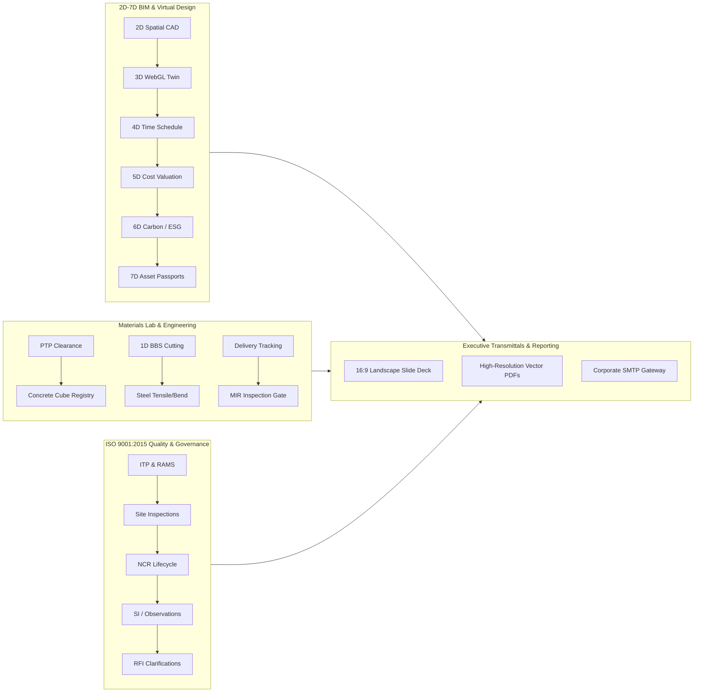
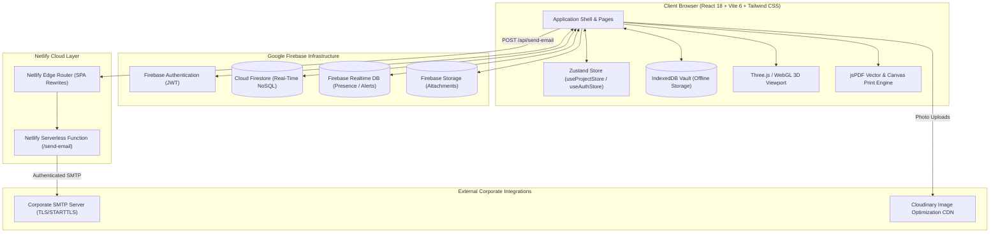

# JQMS Enterprise — Multi-Dimensional Civil & Structural Quality Management System

<div align="center">


**Enterprise-Grade Civil & Structural Quality Governance, 2D–7D BIM Digital Twinning, ISO 9001:2015 Engineering Workflows, Materials Lab Analytics, 1D Rebar Optimization, Executive Landscape Presentation Decks, and Multi-Tenant RBAC.**

[](https://reactjs.org/)
[](https://www.typescriptlang.org/)
[](https://vitejs.dev/)
[](https://tailwindcss.com/)
[](https://threejs.org/)
[](https://firebase.google.com/)
[](https://www.netlify.com/)
[](https://www.iso.org/iso-9001-quality-management.html)
[](LICENSE)

[Executive Summary](#-executive-summary) • [2D–7D BIM Ecosystem](#-2d7d-bim-digital-twin-ecosystem) • [Quality Modules](#-core-quality--engineering-modules) • [Navigation Architecture](#-streamlined-navigation--module-tabs) • [System Architecture](#-system-architecture--data-flow) • [Engineering Standards](#-engineering-standards--compliance) • [RBAC Security](#-role-based-access-control-rbac) • [Getting Started](#-getting-started) • [Deployment](#-build--deployment)

---

</div>

## 📌 Executive Summary

**JQMS Enterprise (Jay-QMS)** is an end-to-end digital quality management and virtual design construction (VDC) platform engineered for tier-1 contractors, structural consultants, supervising engineers, and project owners. 

By unifying **multi-dimensional BIM modeling (2D–7D)**, statutory **ISO 9001:2015 quality assurance workflows**, **concrete & steel laboratory registries**, **material supply chain gatekeeping**, and **executive landscape reporting**, JQMS eliminates disjointed paper documentation and disconnected spreadsheets in favor of an auditable, real-time single source of truth.



---

## 🌐 2D–7D BIM Digital Twin Ecosystem

JQMS features a dedicated multi-dimensional BIM suite accessible via the unified BIM Dimension Navigator (`BIMDimensionNav`), enabling cross-functional tracking from spatial coordinates to lifecycle asset operations:

| Dimension | Module Path | Domain | Description & Capabilities |
| :--- | :--- | :--- | :--- |
| **2D Spatial CAD** | `/project/grid-plan` | Spatial Layout | Interactive structural slab layout with CAD gridline axes (X/Y), element boundary envelopes, click-to-inspect member cards, and real-time inspection defect heatmaps. |
| **3D Structural Twin** | `/project/bim-3d` | Geometric Twin | High-performance Three.js WebGL viewport rendering structural elements (columns, beams, slabs, shear walls) with interactive orbital controls, level slicing, and pour-state color coding. |
| **4D Quality Planner** | `/project/planner` | Time & Gating | Gantt-style time-phased construction timeline synchronizing structural milestones, planned vs. actual concrete pours, and inspection hold point dependencies. |
| **5D Cost & BOQ** | `/project/5d-cost` | Commercial Valuation | Dynamic Bill of Quantities (BOQ) takeoff engine calculating trade breakdown costs (Concrete, Rebar, Formwork, Labor, Plant). Includes project rate overrides and direct Firestore persistence (`updateProjectCostRates`). |
| **6D Embodied Carbon** | `/project/6d-carbon` | Sustainability & ESG | Embodied carbon accounting based on the Inventory of Carbon and Energy (ICE). Computes total $tCO_2e$, carbon intensity ($kgCO_2e/m^3$), and SCM clinker replacement offsets (GGBS/PFA) with Firestore persistence (`updateProjectCarbonFactors`). |
| **7D Asset Passports** | `/project/elements` | Lifecycle & Maintenance | Comprehensive structural member registry providing serialized asset passports, scannable adhesive QR codes, full quality inspection histories, maintenance records, and warranty documentation. |
| **MTO Take-Off** | `/project/mto` | Material Schedules | Automated volumetric and tonnage takeoff engine generating aggregated schedules for concrete grades, rebar weights, and formwork surface areas. |

---

## 🛡 Core Quality & Engineering Modules

### 1. ISO 9001:2015 Quality Assurance & Defect Management
- **Non-Conformance Reports (NCR)** (`/project/ncr`): Full lifecycle governance: Identification $\rightarrow$ Root Cause Analysis $\rightarrow$ Proposed Disposition $\rightarrow$ Corrective & Preventive Action (CAPA) $\rightarrow$ Verification & Close-out, with photo evidence and digital sign-offs.
- **Site Instructions (SI)** (`/project/site-instructions`): Formal contractual directives issued by the Engineer/Consultant with mandatory contractor acknowledgment and real-time compliance tracking.
- **Site Comments & Observations (SC)** (`/project/site-comments`): Rapid on-site snag and hazard logging with severity classification (Minor, Moderate, Critical) and geotagged photographic logs.
- **Request for Information (RFI)** (`/project/rfis`): Engineering clarification tracking connecting contractor technical teams with architectural, structural, and MEP consultants.

### 2. Engineering Submittals & Gating
- **Inspection & Test Plans (ITP)** (`/project/itp`): Master quality inspection plans defining statutory hold points (**H**), witness points (**W**), review points (**R**), and surveillance points (**S**).
- **Material Approval Requests (MAR)** (`/project/mar`): Engineering material submittals with manufacturer test certificates (MTC), technical datasheets, compliance verifications, and consultant approval stamps.
- **Method Statements & RAMS** (`/project/method-statements`): Work execution procedures and Risk Assessment Method Statements (RAMS) review and clearance.
- **QA/QC SOP Manual** (`/project/sop-manual`): Standard Operating Procedures, regulatory references, and quality handbooks accessible directly to field teams.

### 3. Concrete Batching & Testing Laboratory
- **Permit to Pour (PTP)** (`/project/permit-to-pour`): Multi-trade clearance gate requiring sequential sign-offs (Surveyor, Rebar, Formwork, MEP Cast-in, Quality Engineer) prior to authorizing concrete discharge.
- **Concrete Cube Compression Registry** (`/project/cube-tests`):
  - Compliant with **BS EN 12390-3**, **ASTM C39**, and **IS 516**.
  - Automated tracking of 3-day, 7-day, 14-day, and 28-day curing intervals against specified characteristic strength ($f_{ck}$).
  - **Early-Strength Predictive Regression**: Early warning algorithm alerting engineers when 7-day compressive test results project a probable 28-day failure.
  - Density calculations ($kg/m^3$), fracture pattern classification (Satisfactory/Unsatisfactory), and automated batch compliance flags.

### 4. Rebar Analytics & 1D Cutting Optimization
- **Bar Bending Schedules (BBS)** (`/project/bar-cutting`): Rebar scheduling and shape code compliance adhering to **BS 8666** and **ASTM A615**.
- **1D Stock Cutting Optimizer**: Algorithmic linear-programming cutting optimizer calculating optimal cut patterns from 12-meter commercial stock lengths to minimize scrap waste.
- **Steel Tensile & Bend Test Register** (`/project/steel-tests`): Quality records for yield strength ($R_e$), ultimate tensile strength ($R_m$), elongation ratio, and cold-bend ductility testing.

### 5. Material Supply Chain & Receiving
- **Material Deliveries** (`/project/deliveries`): Real-time tracking of site material deliveries, delivery dockets, batch numbers, and stock receipts.
- **Material Inspection Requests (MIR)** (`/project/mir`): Physical gatekeeper receiving inspections on arrival to verify physical condition against approved MAR submittals.

### 6. Executive Reporting & Presentation Deck Engine
- **16:9 Landscape Presentation Deck** (`/project/weekly-reports`): Interactive boardroom-ready reporting cockpit featuring Executive Summaries, Level-by-Level Completion Matrices, Quality Trendlines, Cube Strength Histograms, and Photographic Progress.
- **High-Resolution Vector PDF Generator**: Direct client-side PDF export matching executive slide styling with embedded SVG vector charts and CAD overlays.
- **Corporate SMTP Relay & Signatures**: Serverless email relay sending formal notices with embedded corporate logos and engineer digital signatures.

---

## 🧭 Streamlined Navigation & Module Tabs

To maintain a clean and uncluttered user interface, JQMS employs a **Streamlined Sidebar** paired with contextual **In-Page Sub-Navigation (`ModuleTabNav`)**:

```text
┌──────────────────────────────────────────────────────────────────────────────────┐
│  Streamlined Primary Sidebar       Contextual In-Page Sub-Navigation Tabs        │
├──────────────────────────────────────────────────────────────────────────────────┤
│  📁 Quality Assurance       ───►  [ NCRs ] [ Site Instructions ] [ Observations ] │
│  📋 Submittals & Gating     ───►  [ ITPs ] [ MAR ] [ RFIs ] [ RAMS ] [ SOP Manual]│
│  🧪 Testing & Concrete Lab  ───►  [ Concrete ] [ Steel Tests ] [ BBS ] [ PTP ]   │
│  📦 Supply Chain            ───►  [ Deliveries ] [ Material Inspections (MIR) ]  │
│  📅 Inspections             ───►  [ Quality Inspections ] [ Inspection Schedule ]│
│  📊 Executive Reporting     ───►  [ Executive Overview ] [ Weekly Reports Archive]│
│  🌐 BIM Digital Twin        ───►  [ 2D ] [ 3D ] [ 4D ] [ 5D ] [ 6D ] [ 7D ] [MTO] │
└──────────────────────────────────────────────────────────────────────────────────┘
```

This dual-tier navigation ensures that all related modules are accessible within one click while keeping the primary workspace free of repetitive menu items.

---

## 🏗 System Architecture & Data Flow



---

## 🗂 Project Directory Structure

```text
jay-qms/
├── netlify/
│   └── functions/
│       └── send-email.ts            # Serverless SMTP relay using Nodemailer
├── public/                          # Static assets, fallback logos, fonts
├── src/
│   ├── components/
│   │   ├── bim/                     # 2D–7D BIM Navigation & Viewport components
│   │   │   ├── BIMDimensionNav.tsx  # Unified 2D–7D pill navigation bar
│   │   │   ├── Element3DViewer.tsx  # Three.js 3D WebGL structural viewport
│   │   │   ├── Element5DCostViewer.tsx   # 5D BOQ Cost takeoff & DB persist
│   │   │   └── Element6DCarbonViewer.tsx # 6D Embodied Carbon & DB persist
│   │   ├── common/                  # Shared UI (Sidebar, ModuleTabNav, Navbar, Modals)
│   │   │   ├── ModuleTabNav.tsx     # Contextual in-page horizontal sub-navigation
│   │   │   └── Sidebar.tsx          # Streamlined domain-grouped sidebar
│   │   ├── cube/                    # Concrete cube forms, regression graphs, test matrices
│   │   ├── dashboard/               # Executive dashboard widgets & metric cards
│   │   ├── itp/                     # Inspection & Test Plan builder and cards
│   │   ├── projects/                # Multi-project selector, creator, editor
│   │   ├── registry/                # Structural element cards, filters & table views
│   │   └── reporting/               # Weekly report deck, matrix cockpit, slide components
│   ├── lib/
│   │   ├── audit.ts                 # Audit logging helper
│   │   ├── barCuttingOptimizer.ts   # 1D knapsack stock cutting optimizer
│   │   ├── bbsParser.ts             # BBS shape code and bend dimension parser
│   │   ├── cloudinary.ts            # Image optimization and Cloudinary upload helper
│   │   ├── companyHelper.ts         # Company settings & SMTP configuration manager
│   │   ├── db.ts                    # Firestore CRUD, rates persistence & cache hydration
│   │   ├── idbVault.ts              # IndexedDB local storage engine
│   │   ├── pdfGenerators.ts         # Multi-module jsPDF vector document builder
│   │   ├── permissions.ts           # Role hierarchy, capabilities, and permission checks
│   │   └── rbac.tsx                 # React RBAC Gate components & hooks
│   ├── pages/                       # 30+ Dedicated Domain & Module Pages
│   │   ├── Dashboard.tsx            # Executive KPI cockpit
│   │   ├── ElementRegistry.tsx      # 7D Asset Passport & Member Registry
│   │   ├── GridPlanPage.tsx         # 2D Spatial CAD Grid & Defect Heatmaps
│   │   ├── BIM3DViewerPage.tsx      # 3D Structural WebGL Twin
│   │   ├── QualityPlannerPage.tsx   # 4D Quality & Inspection Timeline Planner
│   │   ├── Cost5DViewerPage.tsx     # 5D Commercial BOQ Cost Takeoff
│   │   ├── Carbon6DViewerPage.tsx   # 6D Embodied Carbon & Sustainability
│   │   ├── MTOViewerPage.tsx        # Material Take-Off Volume/Weight Schedules
│   │   ├── NCRModule.tsx            # Non-conformance registry & workflow
│   │   ├── PermitToPourDetail.tsx   # Concrete pour permit & sign-off gate
│   │   ├── CubeDetails.tsx          # Concrete test register & early strength curve
│   │   ├── SteelTestsPage.tsx       # Rebar tensile & cold-bend test register
│   │   ├── BarCuttingRegistryPage.tsx # 1D Rebar cutting schedule manager
│   │   ├── WeeklyReportDetail.tsx   # 16:9 Landscape Executive Report Deck
│   │   ├── Settings.tsx             # Corporate SMTP configuration & branding
│   │   └── ProfilePage.tsx          # Personal mailbox, signatures & company logo
│   ├── stores/                      # Zustand State Stores
│   │   ├── useAuthStore.ts          # Authentication, user profile & permissions
│   │   └── useProjectStore.ts       # Active project data, cost rates, carbon factors
│   ├── types/                       # TypeScript domain interfaces & enumerations
│   ├── App.tsx                      # App routing, code-splitting & layout wrappers
│   ├── firebase.ts                  # Firebase client SDK initialization
│   ├── index.css                    # Tailwind CSS base styles & CSS custom properties
│   └── main.tsx                     # React DOM root entrypoint
├── netlify.toml                     # Netlify build configuration & redirect routes
├── package.json                     # NPM project metadata & dependencies
├── tsconfig.json                    # TypeScript compiler configuration
├── vite.config.ts                   # Vite configuration & path aliases
└── tailwind.config.js               # Tailwind styling & dark mode palette
```

---

## 🛡 Role-Based Access Control (RBAC)

JQMS enforces a strict 5-tier hierarchical security matrix governing multi-tenant organizations, projects, and field actions:

| Tier | Role Identifier | Level Title | Permissions & Capabilities |
| :---: | :--- | :--- | :--- |
| **5** | `SUPER_ADMIN`<br>`QUALITY_DIRECTOR`<br>`EXECUTIVE_MANAGEMENT` | **Corporate Executive** | Full multi-company management, corporate SMTP configuration, company-wide user management, master trade definitions, and global audit log access. |
| **4** | `PROJECT_MANAGER`<br>`OPERATIONS_MANAGER`<br>`QAQC_MANAGER` | **Project Director / Lead** | Project creation & configuration, team role assignments, ITP master approvals, Weekly Report sign-offs, 5D/6D rate baseline management, and project archival. |
| **3** | `QAQC_ENGINEER`<br>`SENIOR_INSPECTOR`<br>`CONSULTANT_REPRESENTATIVE` | **QA/QC Engineer / Consultant** | Close NCRs, sign off Permit to Pour gates, approve Material Submittals (MAR/MIR), approve RFI responses, and issue formal Site Instructions. |
| **2** | `SITE_ENGINEER`<br>`FIELD_INSPECTOR`<br>`SUBCONTRACTOR_LEAD` | **Field Engineer** | Raise inspection requests, log daily site diary entries, record concrete cube test readings, draft NCRs and RFIs, and enter bar cutting schedules. |
| **1** | `SUBCONTRACTOR_WORKER`<br>`CONSULTANT_OBSERVER`<br>`VIEWER` | **Observer / Subcontractor** | Read-only access to assigned projects, view open punch lists, acknowledge site instructions, and view approved construction drawings. |

---

## 📐 Engineering Standards & Compliance

All engineering calculations, test schedules, and reporting structures comply with international standards:

- **Concrete Compressive Strength**:
  - `BS EN 12390-3`: Testing hardened concrete — Compressive strength of test specimens.
  - `ASTM C39 / C39M`: Standard Test Method for Compressive Strength of Cylindrical Concrete Specimens.
  - `IS 516`: Method of Tests for Strength of Concrete.
- **Reinforcing Steel & BBS**:
  - `BS 8666`: Scheduling, dimensioning, bending, and cutting of steel reinforcement for concrete.
  - `BS 4449`: Steel for the reinforcement of concrete — Weldable reinforcing steel.
  - `ASTM A615 / A615M`: Standard Specification for Deformed and Plain Carbon-Steel Bars for Concrete Reinforcement.
- **Embodied Carbon & Sustainability**:
  - `ICE Database v3.0`: Inventory of Carbon and Energy embodied carbon factors.
  - `EN 15978`: Sustainability of construction works — Assessment of environmental performance of buildings.
- **Quality Management Systems**:
  - `ISO 9001:2015 Clause 9.1`: Monitoring, measurement, analysis, and evaluation of quality performance.

---

## ⚡ Getting Started

### Prerequisites
- **Node.js**: `v18.x` or `v20.x` LTS recommended
- **npm**: `v9.x` or higher (or `pnpm` / `yarn`)
- **Firebase Project**: Firestore, Authentication, and Storage enabled.

### Installation

1. **Clone the Repository**:
   ```bash
   git clone https://github.com/your-org/jay-qms.git
   cd jay-qms
   ```

2. **Install Dependencies**:
   ```bash
   npm install
   ```

3. **Configure Environment Variables**:
   Create a `.env.local` file in the root directory:
   ```env
   VITE_FIREBASE_API_KEY=your_api_key
   VITE_FIREBASE_AUTH_DOMAIN=your_project.firebaseapp.com
   VITE_FIREBASE_PROJECT_ID=your_project_id
   VITE_FIREBASE_STORAGE_BUCKET=your_project.appspot.com
   VITE_FIREBASE_MESSAGING_SENDER_ID=your_sender_id
   VITE_FIREBASE_APP_ID=your_app_id
   
   # Optional: Cloudinary Media CDN for Photo Optimization
   VITE_CLOUDINARY_CLOUD_NAME=your_cloud_name
   VITE_CLOUDINARY_UPLOAD_PRESET=your_unsigned_preset
   ```

4. **Start Local Development Server**:
   ```bash
   npm run dev
   ```
   Open `http://localhost:5173` in your browser.

---

## ⚙ Corporate SMTP & Email Configuration

JQMS supports sending formal notices and reports via custom corporate SMTP relays (e.g., Microsoft 365, Google Workspace, AWS SES, or private SMTP servers):

1. **Configure Corporate SMTP Relay** (`/company/settings`):
   - **Host**: `smtp.office365.com` / `smtp.gmail.com` / `mail.yourcompany.com`
   - **Port**: `587` (STARTTLS) or `465` (SSL)
   - **Authentication**: System sender credentials.
2. **Personal Engineer Signature & Branding** (`/project/profile`):
   - Configure personal sender mailbox credentials if sending directly.
   - Toggle **"Embed Company Logo in Email Signature"** to automatically append company branding to all outgoing emails (NCRs, Weekly Reports, RFIs).

---

## 📦 Build & Deployment

### Production Build
```bash
npm run build
```
Executes TypeScript compilation (`tsc`) and Vite bundling, generating optimized production assets in `dist/`.

### Netlify Deployment
The project is pre-configured with `netlify.toml` for seamless continuous deployment:
1. Link your repository to **Netlify**.
2. Set build command to `npm run build` and publish directory to `dist`.
3. Configure environment variables in Netlify site settings.
4. Deploy — Netlify will build the SPA and deploy the `netlify/functions/send-email.ts` serverless relay.

---

## 📄 License & Intellectual Property

This software and associated documentation files are proprietary and confidential. Unauthorized copying, distribution, modification, or deployment of this software, via any medium, is strictly prohibited without express written permission.

---

<div align="center">
  <sub>Engineered with precision for Civil & Structural Construction Quality Management.</sub>
</div>
